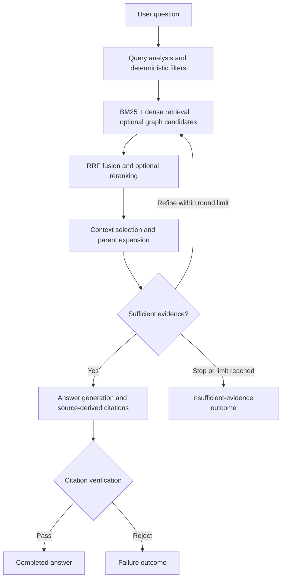

# Vietnamese Legal RAG

A Vietnamese legal question-answering application built with Retrieval-Augmented
Generation (RAG). The system retrieves legal passages, checks whether the evidence
is sufficient, and generates answers with source-linked citations. A React
frontend connects to a FastAPI backend running the local RAG pipeline.

This project is a research prototype based on a selected legal-text snapshot.
Its answers require source inspection and do not establish the current legal
effect of a provision or replace professional legal advice.

## Features

- **Hybrid retrieval:** BM25 and BGE-M3 dense retrieval combined with Reciprocal
  Rank Fusion (RRF).
- **Optional retrieval components:** document-reference graph traversal through
  Neo4j and an ONNX cross-encoder reranker.
- **Hierarchical context:** retrieve leaf chunks and expand to complete parent
  passages when the token budget permits.
- **Evidence checks:** evaluate sufficiency before generation, construct citations
  from retained sources, and verify citation identity, quotations, and
  model-assessed support.
- **Explicit outcomes:** completed, insufficient evidence, failed, and timed out,
  with bounded retrieval refinement.
- **Web interface:** Vietnamese question entry, Markdown answers, citations,
  retained sources, corpus information, and in-memory question history.
- **Evaluation tooling:** dataset validation, controlled retrieval experiments,
  separate scoring, and report exports from stored outputs.

Questions are processed independently. Browser history is not conversational
memory and is cleared when the page is reloaded.

## Architecture



Offline preparation builds the corpus, embeddings, vector index, and graph before
the API starts. Offline benchmark judging is separate from the online checks.

| Component | Current implementation |
| --- | --- |
| Frontend | React 19, TypeScript, Vite |
| API | FastAPI, Uvicorn, Pydantic |
| Local model serving | Ollama |
| Four online LLM roles | `qwen3.5:2b` for query analysis, context sufficiency, generation, and citation verification |
| Embeddings | `bge-m3:latest`, 1,024 dimensions |
| Vector database | PostgreSQL with pgvector; HNSW cosine search |
| Graph database | Neo4j; source-backed document references and chunk hierarchy |
| Reranker | `cross-encoder/mmarco-mMiniLMv2-L12-H384-v1`, ONNX int8 |

Runtime settings are in [`configs/`](configs/). Backend credentials belong in a
local `.env` file at the repository root.

## Getting started

The commands below use **Windows PowerShell**. Run them from the repository root
unless a different directory is specified.

### 1. Install dependencies

Install Git, Python **3.10 or later** (3.12 is the project's documented setup),
Node.js **22.18 or later** with npm, Docker Desktop, and Ollama. Initial preparation
also needs internet access to download source data, tokenizers, and reranker assets.

```powershell
git clone https://github.com/luannt1010/dsp-vietnamese-legal-rag.git
cd dsp-vietnamese-legal-rag

python -m venv .venv
.\.venv\Scripts\Activate.ps1
python -m pip install -e ".[dev]"

ollama pull bge-m3
ollama pull qwen3.5:2b
```

An existing Conda environment can replace `.venv`. Keep the selected Python
environment active for preparation, the backend, and Python checks. Make sure
Ollama is serving; if necessary, run `ollama serve` in a separate terminal.

### 2. Start databases and configure credentials

Start Docker Desktop, then run:

```powershell
powershell -ExecutionPolicy Bypass -File .\scripts\start_demo_databases.ps1

if (-not (Test-Path .\.env)) {
    Copy-Item .\.runtime\demo.env .\.env
}
```

On first setup, the launcher creates the containers, named volumes, and random
credentials in `.runtime/demo.env`. The application uses the root `.env` copy.
When reusing databases, preserve the credentials associated with their volumes
and do not overwrite an existing `.env`. Allow the services to initialize before
continuing. The script retains its original filename for compatibility.

| Service | Container | Default local address |
| --- | --- | --- |
| PostgreSQL + pgvector | `legalrag-pgvector` | `127.0.0.1:15432` |
| Neo4j Bolt | `legalrag-neo4j` | `bolt://127.0.0.1:17687` |
| Neo4j Browser | `legalrag-neo4j` | [http://127.0.0.1:17474](http://127.0.0.1:17474) |
| Ollama | Host application | [http://127.0.0.1:11434](http://127.0.0.1:11434) |

The launcher supports `-PostgresPort` and `-RecreateStoppedContainers` when a
stopped project container needs a different port. Synchronize any connection
changes with the root `.env`.

### 3. Select the corpus and prepare indexes

The source is the community-hosted
[`tmquan/phapdien-moj-gov-vn`](https://huggingface.co/datasets/tmquan/phapdien-moj-gov-vn)
dataset. [`configs/data_pipeline.yml`](configs/data_pipeline.yml) currently selects:

- Transportation and traffic (`Giao thông, vận tải`).
- Science and technology (`Khoa học, công nghệ`).
- Education and training (`Giáo dục, đào tạo`).

Edit topic or subject selectors before preparation. List available selectors,
check connectivity, and prepare the corpus with the existing CLI:

```powershell
python -m scripts.demo --config-dir configs --env-file .env list-topics
python -m scripts.demo --config-dir configs --env-file .env list-subjects
python -m scripts.demo --config-dir configs --env-file .env doctor
python -m scripts.demo --config-dir configs --env-file .env prepare
```

Preparation downloads the selected snapshot, normalizes metadata, creates
hierarchical chunks, embeds leaves, and populates pgvector and Neo4j. The first
run can take substantial time. Later runs reuse compatible prepared data,
embeddings, and healthy indexes. Cached source revisions are reused unless an
explicit refresh is requested; see [corpus preparation](docs/TOPIC_CORPUS.md).

**Prepare indexes before starting the API.** API startup disables automatic
preparation and fails if the required corpus or indexes are missing.

### 4. Run the backend

In a terminal at the repository root, activate the Python environment and select
the runtime configuration explicitly:

```powershell
$env:RAG_CONFIG_DIR = (Resolve-Path .\configs).Path
$env:RAG_ENV_FILE = (Resolve-Path .\.env).Path
python -m src.api
```

Set these variables in each new backend terminal. The API entry point retains
legacy defaults pointing to `configs/demo` and `.runtime/demo.env`; the explicit
selectors above use the current root configuration.

- API: [http://127.0.0.1:8000](http://127.0.0.1:8000).
- Swagger UI: [http://127.0.0.1:8000/docs](http://127.0.0.1:8000/docs).
- Readiness: [http://127.0.0.1:8000/health/ready](http://127.0.0.1:8000/health/ready).

### 5. Run the frontend

In a second terminal, starting at the repository root:

```powershell
cd frontend
npm ci
npm run dev
```

Open [http://127.0.0.1:5173](http://127.0.0.1:5173). Vite proxies `/api` and
`/health` to FastAPI at `http://127.0.0.1:8000`, so the default setup does not
require additional CORS configuration. The frontend calls the API rather than
connecting directly to Ollama or the databases.

Press `Ctrl+C` in the frontend and backend terminals to stop the application.

## Configuration and API

| File | Purpose |
| --- | --- |
| [`configs/config.yml`](configs/config.yml) | API, logging, pipeline deadline, iteration limit, and context budgets |
| [`configs/llm.yml`](configs/llm.yml) | Online model roles, tokenizers, output budgets, and retries |
| [`configs/embedding.yml`](configs/embedding.yml) | Embedding model, dimension, tokenizer, and batching |
| [`configs/retrieval.yml`](configs/retrieval.yml) | Retrieval branches, fusion, reranking, and graph bounds |
| [`configs/database.yml`](configs/database.yml) | Vector and graph backends and connection settings |
| [`configs/data_pipeline.yml`](configs/data_pipeline.yml) | Source selection, chunking, and artifact paths |

Environment overrides use `RAG__SECTION__FIELD`, for example
`$env:RAG__API__PORT = '8001'`. Process variables take precedence over the selected
dotenv file and YAML settings. The low-level `load_settings()` function does not
read `.env` itself; the API and CLI entry points handle dotenv loading.

The current pipeline allows up to three retrieval rounds with a 240-second
deadline. The default API inference limit is one concurrent request per worker.
See [configuration](docs/CONFIGURATION.md) for details.

| Method | Endpoint | Purpose |
| --- | --- | --- |
| `GET` | `/health/live` | Process liveness |
| `GET` | `/health/ready` | Loaded runtime readiness |
| `GET` | `/api/v1/corpus` | Served corpus identity, revision, topics, and counts |
| `POST` | `/api/v1/questions` | Process one independent question |

A request has the form `{"query": "..."}`. Completed answers and insufficient
evidence use HTTP 200; pipeline failures use 502 and timeouts use 504. An
unavailable or busy service returns 503. Readiness reports runtime state rather
than performing a live check of every downstream service. See the
[API reference](docs/API.md) for schemas.

For terminal-based question answering:

```powershell
python -m scripts.demo --config-dir configs --env-file .env chat
```

## Build preview and optional remote access

Keep the backend running. From `frontend/`, build and preview the application:

```powershell
npm run build
npm run preview
```

The build is written to `frontend/dist/`. Preview runs at
[http://127.0.0.1:4173](http://127.0.0.1:4173) with the same API proxy.

If ngrok is installed, expose the preview from a separate terminal:

```powershell
ngrok http 4173
```

If Vite blocks the tunnel hostname, set it in the preview terminal before
restarting preview:

```powershell
$env:__VITE_ADDITIONAL_SERVER_ALLOWED_HOSTS = 'your-host.ngrok-free.app'
npm run preview
```

Replace the example hostname with your tunnel's hostname. Remote access requires
the host machine, preview, backend, Ollama, databases, and tunnel to remain
running. This local preview setup has no built-in user authentication and is
intended for controlled project demonstrations.

## Evaluation and benchmarks

The normalized development dataset contains **45 answerable questions**, with 15
per topic, **233 reference claims**, and **115 evidence spans**:
[`three_topics_pilot.development.v1.jsonl`](data/evaluation/new/three_topics_pilot.development.v1.jsonl).
See the [dataset notes](data/evaluation/new/README.md) for provenance and annotation
limits.

All configurations include BM25, dense retrieval, and RRF:

| ID | Graph | Reranker | Maximum retrieval rounds |
| --- | --- | --- | --- |
| B0 | No | No | 1 |
| B1 | No | Yes | 1 |
| B2 | Yes | No | 1 |
| B3 | Yes | Yes | 1 |
| B4 | Yes | Yes | 3 |

After preparing the matching corpus, run from the repository root:

```powershell
python -m scripts.benchmark validate --dataset data/evaluation/new/three_topics_pilot.development.v1.jsonl

$benchOut = '.runtime/benchmarks/three-topics-development-01'
python -m scripts.benchmark run --config-dir configs --env-file .env --dataset data/evaluation/new/three_topics_pilot.development.v1.jsonl --split development --config configs/benchmark/smoke.yml --output $benchOut
python -m scripts.benchmark score --output $benchOut --retrieval-only
python -m scripts.benchmark report --output $benchOut
```

The validation command above checks dataset structure. To resolve evidence
quotations as well, add `--corpus` with the prepared `corpus.json` path. The
benchmark run resolves evidence against its prepared corpus before inference.

With this dataset, `smoke.yml` runs one repeat across B0–B4: **225 measured
executions**, plus excluded warm-up queries. The dataset controls the question
count. `hybrid.yml` requests three repeats instead. Use a new output directory
when changing questions, labels, settings, models, or code; reuse a directory only
to resume a compatible interrupted run.

Retrieval-only scoring does not call a quality judge. Reports are exported under
`$benchOut/reports/`; semantic context and answer metrics remain unavailable until
model-based scoring is performed.

The default offline judge is `qwen3.5:2b` with `allow_same_model=false`. It cannot
score the current 2B generator. Configure and install a distinct judge, including
matching tokenizer settings, before requesting semantic scores:

```powershell
python -m scripts.benchmark score --config-dir configs --env-file .env --output $benchOut --judge-config configs/benchmark/judging.yml
python -m scripts.benchmark report --output $benchOut
```

These last two commands assume the judge configuration has already been changed.
Metric definitions, scoring artifacts, and paired statistics are documented in
the [benchmark guide](docs/BENCHMARK.md).

### Interpreting the experiments

The historical development benchmark used 2B models for query analysis and
citation verification, and 4B models for context sufficiency and generation.
**The current web configuration uses 2B for all four roles.** Historical scores
and timings therefore do not measure the current all-2B configuration.

The questions informed development and are not a held-out final test. Labels
remain pending independent legal review. Completion rate measures workflow
completion rather than legal accuracy; model-judged quality scores require
calibration. The graph uses document references, and enabling it does not by
itself demonstrate graph-grounded multi-hop reasoning.

## Development checks

From the repository root, with the Python environment active:

```powershell
$env:RAG_CONFIG_DIR = (Resolve-Path .\configs).Path
$env:RAG_ENV_FILE = (Resolve-Path .\.env).Path

python -m pytest -q
powershell -ExecutionPolicy Bypass -File .\tests\test_database_launcher.ps1
npm --prefix frontend test
npm --prefix frontend run build
npm --prefix frontend run api:check
npm --prefix frontend run format:check
```

Standard tests use fixtures and do not require live inference or databases.
Database integration tests are opt-in through `RAG_RUN_DB_TESTS=1`. The launcher
regression script simulates Docker operations. `api:check` imports the Python app
without starting its runtime; it needs installed Python dependencies and the
configuration selectors shown above.

## Troubleshooting

| Symptom | Check |
| --- | --- |
| Missing `configs/demo` or configuration errors at API startup | Set `RAG_CONFIG_DIR` to root `configs/` and `RAG_ENV_FILE` to root `.env` in that terminal. |
| Missing corpus or indexes | Run preparation before restarting the API. |
| Model or database connection errors | Ensure Ollama and Docker are running, then run the CLI `doctor` command. Confirm `.env` matches database credentials and ports. |
| Existing database volumes but no credentials file | Restore the original `.runtime/demo.env`; generating new passwords does not change credentials in existing volumes. |
| Frontend cannot reach the backend | Start FastAPI on the proxy target. If its port changes, update `API_PROXY_TARGET` and restart Vite. |
| Judge equals generator during semantic scoring | Configure a distinct judge model or use retrieval-only scoring. |
| Question request returns 503 while another is running | The default inference limit is one request per worker. Wait for the current request to finish. |

## Repository layout and documentation

```text
configs/             Runtime and benchmark configuration
core/                Shared schemas, interfaces, configuration, and errors
src/
  api/               FastAPI application and HTTP contracts
  data_pipeline/     Source loading, parsing, chunking, and embedding preparation
  retrieval/         BM25, dense retrieval, fusion, routing, and reranking
  knowledge_graph/   Graph construction and bounded retrieval
  generation/        Context building, answer generation, and citation verification
  orchestration/     Pipeline execution and feedback
  benchmark/         Dataset validation, execution, scoring, and reporting
frontend/            React web application
prompts/             Versioned prompts
scripts/             Runtime, ingestion, benchmark, and database utilities
tests/               Unit, API, benchmark, and opt-in database tests
data/evaluation/     Evaluation datasets and annotation notes
docs/                Technical and implementation documentation
```

- [Web application](docs/WEB_APP.md)
- [API contract](docs/API.md)
- [Configuration](docs/CONFIGURATION.md)
- [Corpus preparation](docs/TOPIC_CORPUS.md)
- [Retrieval](docs/RETRIEVAL.md)
- [Context construction](docs/CONTEXT_BUILDER.md)
- [Citation verification](docs/CITATION_VERIFICATION.md)
- [Benchmark methodology](docs/BENCHMARK.md)

This README describes the current web profile. Some implementation documents
retain earlier setup examples; use the explicit configuration paths shown here
for the current application. Most detailed documents are written in Vietnamese.

Credentials, `.runtime/`, prepared indexes in `data/runtime/`, local report and
slide sources in `final_report_slide/` and `reports/`, and exported artifacts in
`output/` are excluded by `.gitignore`. They are not part of a fresh GitHub clone;
prepare runtime artifacts locally using the steps above. Never place backend
credentials in public frontend `VITE_*` variables.
